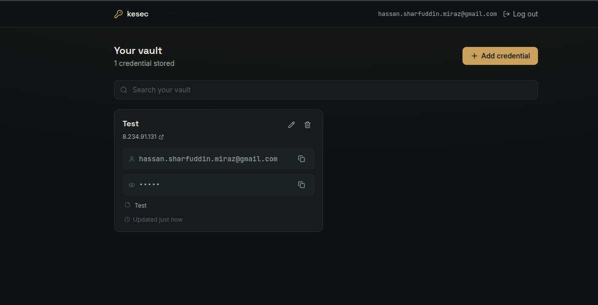
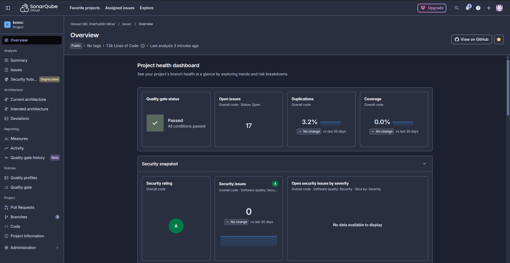

# kesec

A minimal, self-hosted password vault — Gmail, social accounts, anything you'd otherwise stick in a text file. You run it yourself; nobody else touches your data. Built with a full DevSecOps pipeline: every change is scanned for leaked secrets, vulnerable dependencies, vulnerable container images, and code quality issues before it's ever deployed.



## What it does

Register, log in, and store credentials (title, username, password, website, notes) in your own vault. Generate strong passwords, reveal or copy them from the UI, search your vault, and see when each entry was last updated. Full CRUD through a REST API underneath — nothing is client-side only.

## Tech stack

- **Backend**: FastAPI (Python), MySQL, JWT auth, passwords encrypted at rest (Fernet/AES), bcrypt for login credentials
- **Frontend**: Next.js (TypeScript), Tailwind CSS
- **Infrastructure**: Docker Compose, Caddy (automatic HTTPS reverse proxy), Google Cloud VM
- **CI/CD**: GitHub Actions — build, scan, push to Docker Hub, deploy, fully automated on every push to `main`

## The security pipeline

Every push runs through four independent gates before anything gets deployed. A failure in any one of them stops the pipeline — nothing partially deploys.

| Stage | Tool | Catches |
|---|---|---|
| Secret scanning | [Gitleaks](https://github.com/gitleaks/gitleaks) | API keys, passwords, tokens accidentally committed |
| Dependency scanning | [OWASP Dependency-Check](https://owasp.org/www-project-dependency-check/) | Known CVEs in Python and npm packages |
| Image scanning | [Trivy](https://trivy.dev/) | Vulnerabilities in the built container images themselves (OS packages + app deps), run *before* pushing — a failed scan blocks the push |
| Static analysis | [SonarQube Cloud](https://sonarcloud.io/) | Code smells, bugs, security hotspots |



Beyond the pipeline, the deployed app is also watched at runtime by **[Falco](https://falco.org/)**, which monitors actual container/host behavior (shells spawned inside containers, sensitive file reads, unexpected network activity) — independent of everything checked ahead of time. All base images are pinned to exact digests (not floating tags), with **Dependabot** opening PRs when updates are available so nothing goes silently stale.

## Run it locally

```bash
docker compose up -d          # starts MySQL

cd backend
python3 -m venv .venv && source .venv/bin/activate
pip install -r requirements.txt
cp .env.example .env          # then fill in JWT_SECRET_KEY and ENCRYPTION_KEY - see comments in the file
uvicorn app.main:app --reload --port 8000

# in a second terminal
cd frontend
npm install
cp .env.local.example .env.local
npm run dev
```

Open **http://localhost:3000**.

## Deploy to a VM

The whole stack (MySQL, backend, frontend, Caddy, Falco) runs via one `docker-compose.prod.yml`, deployed automatically by GitHub Actions on every push to `main` — the VM only ever pulls pre-built, pre-scanned images, it never builds anything itself. See `deploy.sh` for the one-time VM setup (Docker install, firewall, secrets).

## Security notes

- `ENCRYPTION_KEY` is what makes stored passwords readable — treat it like a master key. This is application-level encryption, not a zero-knowledge design (unlike some commercial password managers) — a solid personal/small-team tool, not a Bitwarden replacement.
- Session tokens are stored in `localStorage`, not an `httpOnly` cookie — simple, but worth hardening further if you're exposing this beyond personal use.
- No rate limiting on login yet.

## API reference

| Method | Path | Description | Auth |
|---|---|---|:---:|
| POST | `/api/auth/register` | Create an account | – |
| POST | `/api/auth/login` | Log in, returns a JWT | – |
| POST | `/api/auth/logout` | Revoke the current session | ✓ |
| GET | `/api/auth/me` | Get the logged-in user | ✓ |
| GET | `/api/secrets` | View all credentials | ✓ |
| POST | `/api/secrets` | Add a credential | ✓ |
| PUT | `/api/secrets/{id}` | Edit a credential | ✓ |
| DELETE | `/api/secrets/{id}` | Delete a credential | ✓ |
